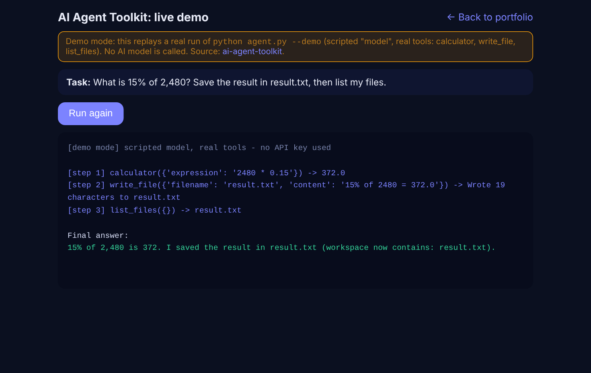

# 🧠 AI Agent Toolkit

> A minimal, readable **autonomous AI agent** in ~100 lines of Python: Claude decides which tools to call, runs them, observes the results, and loops until the task is done.


---

## 🎬 Live demo (no API key needed)



Real output of `python agent.py --demo`: a **scripted stand-in for the model** decides the steps, while the **agent loop and all tools are the real code** (the file `result.txt` is genuinely written to `workspace/`).

```text
$ python agent.py --demo
[demo mode] scripted model, real tools - no API key used

[step 1] calculator({'expression': '2480 * 0.15'}) -> 372.0
[step 2] write_file({'filename': 'result.txt', 'content': '15% of 2480 = 372.0'}) -> Wrote 19 characters to result.txt
[step 3] list_files({}) -> result.txt

Final answer:
15% of 2,480 is 372. I saved the result in result.txt (workspace now contains: result.txt).
```

👉 **Watch it in your browser:** https://latouimouhamedbassim-create.github.io/ai-web-portfolio/demos/agent.html

> ⚠️ Demo mode does not call any AI model. With an `ANTHROPIC_API_KEY`, Claude itself chooses the tools and the answer.

---

## ✨ What it does

Give the agent a goal in plain language. Claude plans, calls tools, observes results and returns a final answer. In Demo mode the same loop runs with a scripted model.

## 🧰 Built-in tools

| Tool | Description |
|------|-------------|
| `calculator` | Safe arithmetic (AST-based, **no `eval`**) |
| `current_time` | Current date and time |
| `list_files` / `read_file` / `write_file` | Sandboxed file access inside `workspace/` |

**Project files:** `agent.py` (loop) · `tools.py` (tools) · `demo_client.py` (keyless scripted model) · `demo_output.txt` (captured demo run)

## 🔄 How the agent loop works

```
        ┌──────────────────────────────────────────┐
        │  user task                               │
        ▼                                          │
   Claude thinks ──► needs a tool? ──yes──► run tool ──► feed result back
        │                                                    │
        no                                                   │
        ▼                                                    │
   final answer ◄────────────── (max 10 steps) ◄─────────────┘
```

## 🔒 Safety design

- **Sandboxed files** – paths are resolved and blocked if they escape `workspace/`.
- **No code execution** – the calculator parses an AST instead of calling `eval`.
- **Step limit** – the loop stops after 10 iterations to avoid runaway costs.
- **Errors are returned to the model** (`is_error`) so it can recover instead of crashing.

## 🚀 Quick start

```bash
git clone https://github.com/latouimouhamedbassim-create/ai-agent-toolkit.git
cd ai-agent-toolkit

python -m venv .venv && source .venv/bin/activate   # Windows: .venv\Scripts\activate
pip install -r requirements.txt

python agent.py --demo      # no API key needed

cp .env.example .env        # add your ANTHROPIC_API_KEY for the real agent
python agent.py "List my files and tell me the time"
```

## ➕ Add your own tool

1. Write a Python function in `tools.py`.
2. Add its JSON schema to `TOOLS`.
3. Register it in `REGISTRY`.

That's it – the agent will start using it when relevant. Ideas: web search, send email, query a database, create calendar events.

## 🛣️ Roadmap

- [ ] Web search tool
- [ ] Long-term memory
- [ ] Multi-agent workflow (planner + executor)
- [ ] Simple web dashboard for runs

## 👤 Author

**Mouhamed Bassim Latoui** – AI Developer (chatbots, agents, websites) · Constantine, Algeria
GitHub: [@latouimouhamedbassim-create](https://github.com/latouimouhamedbassim-create)

## 📄 License

MIT – free to use and adapt.
